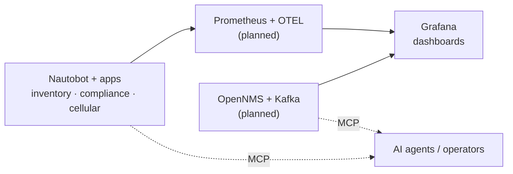

<!--
  Lipford-Dutch org profile. Sections between goc:* markers are rewritten
  weekly by .github/workflows/goc-profile-refresh.yml (scripts/render_profile.py).
-->

  

  
  
  
  
  
  

<h3 align="center">A proving ground for infrastructure, observability, commerce, civic systems, and the ideas we refuse to leave on paper.</h3>

## 🚀 Now shipping

T3 Code is the team's day-to-day coding console on the GoC lab machines. There is no public GoC repo for it yet.

In-flight work we are promoting now:

<table>
<tr>
<td width="33%" valign="top">

**Auto guide publisher** 
The GoC guide library: a searchable, Pages-hosted library of step-by-step field guides with a CI publisher. 
[library](https://lipford-dutch.github.io/goc-guide-library/) · [repo](https://github.com/Lipford-Dutch/goc-guide-library)

</td>
<td width="33%" valign="top">

**Uncensored AI** 
Self-hosted private AI stack (Ollama and a local prompts library) with a public living guide. 
[guide](https://willyd61.github.io/goc-private-ai/) · private beta

</td>
<td width="33%" valign="top">

**Legacy integration system** 
Resilient Interoperability Gateway (RIG): a discovery-stage, vendor-neutral framework for modernising legacy infrastructure. 
[public overview](https://rig-project-overview.willyd61.chatgpt.site) · private beta

</td>
</tr>
<tr>
<td valign="top">

**Batfish efforts** 
Network configuration analysis, including a Nautobot-oriented Batfish lane. 
private beta · no public repo yet

</td>
<td valign="top">

**Nautobot OTEL integration** 
Planned OpenTelemetry path in the observability fabric (Nautobot → Prometheus + OTEL → Grafana), as described on the HQ site. A dedicated repo has not been published yet. 
[HQ / fabric](https://cbgoc-cloud.top)

</td>
<td valign="top">

**Energy management** 
In flight. A public repo has not been published yet. 

</td>
</tr>
</table>

**Prompt library:** the public prompt collection at [willyd61/awesome-chatgpt-prompts](https://github.com/willyd61/awesome-chatgpt-prompts) (upstream [prompts.chat](https://prompts.chat)), deployed as the local prompts-chat app documented in the [private AI guide](https://willyd61.github.io/goc-private-ai/).

**Wiki / field manuals:** the public knowledge base is the [GoC guide library](https://lipford-dutch.github.io/goc-guide-library/). Kickoff and governance notes also live in the [base template docs](https://lipford-dutch.github.io/GOC-Base-Repo-Template/) and its [wiki](https://github.com/Lipford-Dutch/GOC-Base-Repo-Template/wiki).

## ⚔️ Active theaters

<!-- goc:theaters:start -->
<table>
<tr>
<td width="33%" valign="top">

**01 · Wireless Cellular SoT** 
Nautobot app for wireless and cellular routers, SIM cards and carrier source-of-truth workflows. 
[repo](https://github.com/Lipford-Dutch/nautobot-wireless-cellular-sot-app) · [launch page](https://lipford-dutch.github.io/nautobot-wireless-cellular-sot-app/cellular.html)

</td>
<td width="33%" valign="top">

**02 · Nautobot Custom Metrics** 
Alpha Nautobot app for ROI, activity and platform telemetry metrics. 
[repo](https://github.com/Lipford-Dutch/nautobot-app-custom-metrics) · [launch page](https://lipford-dutch.github.io/nautobot-app-custom-metrics/)

</td>
<td width="33%" valign="top">

**03 · F5 Staging Precheck** 
Parallel SSH and iControl REST audit framework for F5 BIG-IP change-window readiness. 
[repo](https://github.com/Lipford-Dutch/f5-staging-precheck) · [docs](https://lipford-dutch.github.io/f5-staging-precheck/)

</td>
</tr>
<tr>
<td valign="top">

**04 · Citizen Karen** 
Consent-first civic complaint intake and tracking demo with accessible workflows and observability. Not a government service. 
[repo](https://github.com/Lipford-Dutch/citizen-karen-platform) · [demo](https://lipford-dutch.github.io/citizen-karen-platform/)

</td>
<td valign="top">

**05 · Carolina Beach 411** 
Mobile-first guide to Carolina Beach vendors, Town News, beach-day planning and seasonal themes. 
[repo](https://github.com/Lipford-Dutch/carolina-beach-local-411) · [live guide](https://lipford-dutch.github.io/carolina-beach-local-411/)

</td>
<td valign="top">

**06 · GOC Base Repo Template** 
Day-zero kickoff for every new repo: docs, CI/CD, security, triage, Pages and release governance. 
[template](https://github.com/Lipford-Dutch/GOC-Base-Repo-Template) · [docs](https://lipford-dutch.github.io/GOC-Base-Repo-Template/)

</td>
</tr>
</table>
<!-- goc:theaters:end -->

## 🛰️ What we're shipping

<!-- goc:feed:start -->
| When | Repo | Signal |
| --- | --- | --- |
| 2026-11-24 | [goc-guide-library](https://github.com/Lipford-Dutch/goc-guide-library) | GoC step-by-step guide library. |
| 2026-11-24 | [Hannah-Huffman-Wealth-Horizon](https://github.com/Lipford-Dutch/Hannah-Huffman-Wealth-Horizon) | Hannah's Wealth Horizon: an interactive 10-year family roadmap for financial independence, |
| 2026-11-24 | [GOC-DEMO-ASSETS-1](https://github.com/Lipford-Dutch/GOC-DEMO-ASSETS-1) | Various Generals of Chaos Demo Assets |
| 2026-11-24 | [f5-staging-precheck](https://github.com/Lipford-Dutch/f5-staging-precheck) | check_multi 2.0 + bigip-precheck: parallel SSH and iControl REST audit framework for F5 BI |
| 2026-11-24 | [citizen-karen-platform](https://github.com/Lipford-Dutch/citizen-karen-platform) | Consent-first civic complaint intake and tracking demo with plugin-driven agency simulatio |
| 2026-11-22 | [nautobot-wireless-cellular-sot-app](https://github.com/Lipford-Dutch/nautobot-wireless-cellular-sot-app) | Nautobot app for wireless and cellular router, SIM card, and carrier Source of Truth workf |
<!-- goc:feed:end -->

  <!-- goc:stats:start -->
  
  <!-- goc:stats:end -->

## 🧭 Workstreams

| Lane | What lives here |
| --- | --- |
| **Network source of truth** | Nautobot apps for cellular SoT and custom metrics; [OpenNMS MCP](https://github.com/Lipford-Dutch/opennms-mcp) exposes alarms, nodes and events to MCP clients. |
| **Upgrade readiness** | F5 BIG-IP prechecks and zero-touch TMOS upgrade automation. |
| **Observability fabric** | Nautobot → Prometheus + OTEL → Grafana, with OpenNMS + Kafka planned upstream. |
| **Civic & local** | Citizen Karen civic intake demo and the Carolina Beach 411 local guide. |
| **Commerce & brand** | [Pleasure Island Design](https://www.pleasureislanddesign.com), Nollies and Hoplite on [cbgoc-cloud.top](https://cbgoc-cloud.top). |
| **Field manuals** | [WTFManuals](https://github.com/Lipford-Dutch/wtfmanuals), the [guide library](https://lipford-dutch.github.io/goc-guide-library/) (our public wiki) and the base repo template. |
| **Private AI** | Self-hosted uncensored AI stack and the [prompts library](https://github.com/willyd61/awesome-chatgpt-prompts); public guide at [goc-private-ai](https://willyd61.github.io/goc-private-ai/). |
| **Interoperability** | Legacy integration (RIG) in private beta; [public overview](https://rig-project-overview.willyd61.chatgpt.site). |
| **Contractor tech** | Keith's Contractor Takeoff and Ködade ADE lanes (see [@ContractorKeith](https://github.com/ContractorKeith)). |
| **Brand** | Official kit: [goc-brand-kit](https://github.com/Lipford-Dutch/goc-brand-kit). |

## 🎖️ The Generals

<table>
<tr>
<td width="50%" valign="top">

**[Will Lipford](https://github.com/willyd61)** · Carolina Beach 
Network automation, DevOps and field systems. Turns messy operating reality into Nautobot apps, CI pipelines and launch pages.
</td>
<td width="50%" valign="top">

**[Keith Bloemendaal](https://github.com/ContractorKeith)** · [contractorkeith.com](http://contractorkeith.com) 
37 years in the trades, now an agentic engineer. Building Ködade ADE (open source) and Contractor Takeoff.
</td>
</tr>
</table>

## 🧰 Stack

  
  
  
  
  
  
  
  
  
  
  
  
  
  

## 📡 Rules of engagement

- Every repo is **active**, **reference** or **archived**. No silent clutter.
- New repos start from the [GOC Base Repo Template](https://github.com/Lipford-Dutch/GOC-Base-Repo-Template).
- Proof lives next to the code: CI, docs and a launch page for anything we call shipped.
- Client and product lanes stay private until cleared.

<b>GENERALS OF CHAOS</b> / Build. Observe. Iterate. · <a href="https://cbgoc-cloud.top">cbgoc-cloud.top</a>

